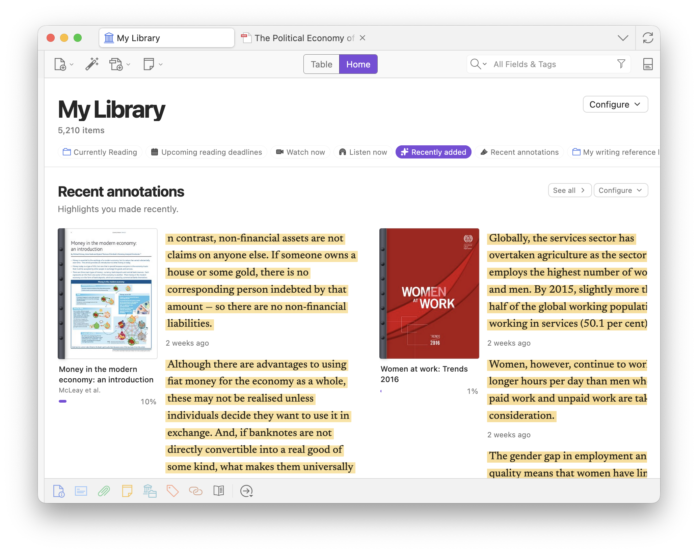

A timeline of your highlights, notes, and area-annotation images across sources, in chronological order.

## Open the feed

1. Enable **Annotation Feed** in **Preferences → Zotero Syllabus → Views**.
2. Open the **Annotation Feed** tab (toolbar, or **Go to Annotation Feed** from Home).
3. Or right-click an item (or its cover in Gallery) → **Open annotation feed** to open the feed already isolated to that work.

## Timeline

On wider windows, a left-hand outline sits beside the feed (outside the main column). It lists each date once, then each source once per day. Click a title to jump to that run in the feed. Use **<<** / **>>** at the top of the outline to collapse or expand it.

## Single book

To review one source without scrolling the whole library timeline:

- Click its cover in the Annotation Feed,
- Right-click the item → **Open annotation feed**, or
- In Gallery **Annotations** layout, use **Open annotation feed** under the cover.

The header becomes **Annotations for …**; click **Show annotations for all items** underneath to return to the library feed.

## Search

Use the search icon in the header to find matches across your library. The popover lets you choose:

- **Annotations and Full Text**
- **Annotations Only**
- **Full Text Only**

Annotation hits match **quote** or **comment** text; full-text hits show matching paragraphs in the same quote style without a highlight color. Clear the box to return to the full library timeline.

## Options

Open the options menu to:

- **Order** — newest last (oldest at the top) or newest first.
- **Quote order** — under each item, by location in the document or by date added.
- **Filter by colour / tag** — show only matching annotations (empty filter = everything).
- **Copy** — when you copy from the feed, optionally prefix Markdown blockquotes (`>`) and append Pandoc cite keys (`[@…]`, from Better BibTeX or the item Citation Key field). The same defaults live in Preferences.

## Saved views

When a colour or tag filter is active, the options **⋯** shows a blue dot, and under the title you get **Clear filters** (and **Save view** when the current setup doesn’t already match a saved view). **Save view** stores the current order, quote order, and filters as a named view (in your global preferences). Pills appear to the left; click one to apply those filters, or click the active pill again to clear them. Right-click a pill → **Delete view** to remove it. The active pill highlights when the live filters match that view.

Scroll to the older end of the feed (top when newest is last, bottom when newest is first) to load an earlier page automatically — or use **Load previous**. When you reach the oldest item, a **Your first annotation** marker appears (or **Start of results** in search). Click a quote, area image, or full-text paragraph to open it in the reader.

Area annotations (figures, diagrams, equations) show their captured image inline when Zotero has cached it. The same images appear on an item’s public share page when you publish with annotations included.

Quote order under each item (by location in the document, or by date added) is shared with Gallery Annotations and Home’s recent-annotations shelf.
