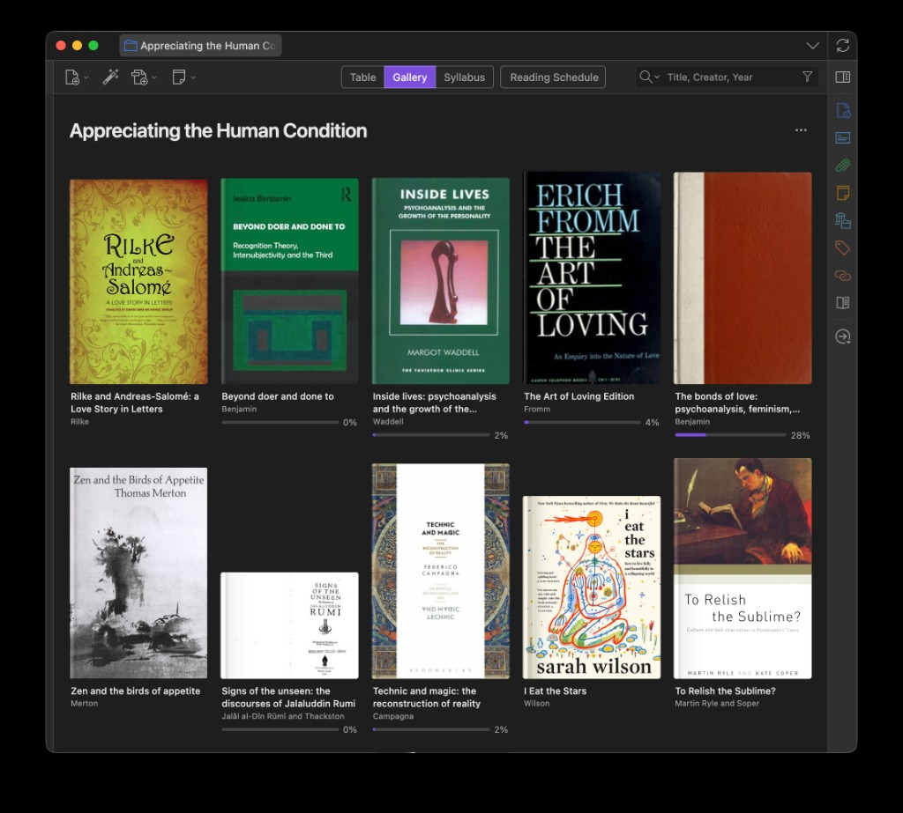

Browse one collection as a **reading list** — covers, cards, a preview of excerpts, or an annotation stream — without turning it into a syllabus. Switch with **Gallery** in the items toolbar.

Covers come from attached images, EPUB/PDF art, ISBN lookups, or type-specific placeholders (for example journals as a first page, letters and emails as a sealed envelope with the title handwritten). Reading progress shows when available. If Zotero’s **Show Items from Subcollections** is on, those items are included.

Open **View options** from the `(view / sort / group)` control in the header. Choices are stored per collection. The globe button (**Save as default**) copies the current choice to collections that have not set their own. When you group items, a pill strip under the title jumps to each section.

Click a cover or card to select it in Zotero; double-click opens the best attachment.

Under the title you can **Add a description…** — a short blurb for the reading list. It is stored on the collection’s Personal Reading Order note (not the Syllabus note) and appears at the top of Gallery exports and published gallery pages. If you later turn the collection into a syllabus, that blurb is copied onto the Syllabus description when the syllabus is created.

An empty collection shows a **Start a reading list** prompt with a short how-to (add items, set reading order, optional description). **Add items** opens the library picker at the library root so you can choose items from elsewhere in the library.

## View modes

- **Cover** — artwork in a grid. Best for scanning books, papers, and web pages at a glance.
- **Card** — reading cards (title, creators, notes) in a narrower column. **Density** (Row / Standard / Expanded) is available in this mode.
- **Preview** — covers with excerpt blurbs beside them, using the same layout as Annotations. Items without a preview sit in a horizontal cover row.
- **Annotations** — covers with every highlight and note on the item. **Quotes** orders those excerpts by location in the document or by date added. Check **Show items with no annotations** to keep items without highlights in the list.

## Sort

- **Auto** — collection order, or syllabus class order on a syllabus.
- **A–Z** — title.
- **Date** — item date, newest first.
- **Added** — date added, newest first.
- **Last Read** — most recently opened first.
- **Personal Reading Order** — your custom order when set; see [Personal reading order](/zotero-syllabus/concepts/personal-reading-order/).

## Group by

- **None** — one continuous list.
- **Automatic** — Preview only; builds shelves from classes, child collections, and frequent tags.
- **Type** — books, journal articles, web pages, and so on.
- **Creator**
- **Tags**
- **Collections** — child collections (when this folder has any).

On Home collection shelves (not Gallery itself), syllabus collections can also **Group by Classes**.

## Gallery notes

A Gallery note is a short, collection-specific caption on an item — a reminder, a why-this-matters line, or a quote next to the cover. It is not a normal Zotero note, a reading instruction, or a pin intention.

The note belongs to **this collection**. The same item in another collection can have a different Gallery note, or none.

1. Select the collection (Table or Gallery).
2. Right-click an item → **Add Gallery Note** (or **Edit Gallery Note**).
3. Write in Zotero’s note editor.

Click a Gallery note on a card, cover, or preview tile to open it. Right-click → **Remove Gallery Note** deletes only this collection’s Gallery note.

How it looks: under the title on **Card**; in the sidecar on **Preview**; beside the cover in **Cover**; still on the item in **Annotations**.

Use Gallery **View options → Show personal notes** to hide or show these captions without deleting them. The setting is per collection (same pattern as **Show checkboxes**).

## Done items

Sort by **Reading order**. That list is headed **N prioritised items** (for example, “3 prioritised items”). Items that are not in the order sit under **N unprioritised items**.

Turn on **Show checkboxes**, then tick an item when you have finished it. **Separate done items** (on by default, also in View options) moves those items out of both lists into a **Done** section directly under the prioritised items. The section lists the most recently finished item first. Drag an item from Done into **prioritised** or **unprioritised** to put it back in that list and clear its done tick. The Done heading looks like “☑️ 2 done items”. It starts open; click it to collapse the section. Untick **Separate done items** to leave finished items in whichever list they were in. Both settings are stored per collection, and **Save as default** copies them to collections that have not set their own.

## Print, export, and share

Use the globe icon in the Gallery header to **Publish online…**. You can also right-click the collection → **Share via URL**. The share wizard can publish as a personal reading list (mirroring Gallery view options) or as a syllabus when the collection has one. Checkboxes, read status, and Gallery notes stay private. (Syllabus view still has the printer menu for PDF / Word / Markdown / HTML.) Details: [Print, export, and publish](/zotero-syllabus/how-to/print-export-publish/).
